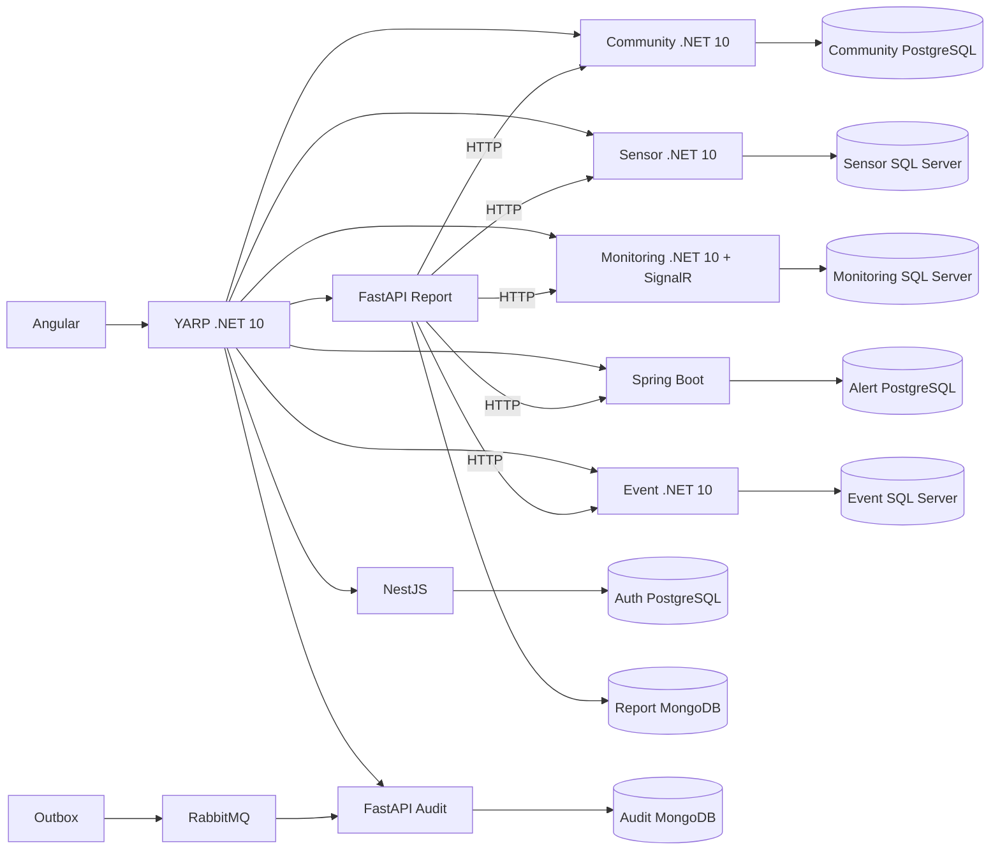

# Fase 3 — Arquitectura y diagnóstico inicial

Estado: arquitectura objetivo implementada y validada en el alcance local acordado. La tabla siguiente conserva el inventario anterior y estados iniciales. Evidencia actual en FASE_3_PRUEBAS.md y punto de continuación del workspace.

## Inventario inicial (2026-10-21)

| Componente | Implementación comprobada | Datos y comunicación | Estado para Fase 3 |
| --- | --- | --- | --- |
| Gateway | `src/Gateway/Climate.Gateway/Program.cs`, YARP 2.3.0, .NET 10 | HTTP, WebSocket, CORS, limitador fijo; sin base propia | PARCIAL: falta validación JWT inicial, CorrelationId y nuevos destinos |
| Identity | `src/Services/IdentityService`, capas Domain/Application/Infrastructure/Api | IdentityDb SQL Server, Users, ASP.NET Identity PBKDF2, JWT HS256, Outbox | PENDIENTE migración a NestJS/PostgreSQL |
| Sensor | `src/Services/SensorService` | SensorDb SQL Server, Communities/Sensors, FK local, Outbox; API interna autenticada | PARCIAL: extraer comunidades sin perder referencias |
| Monitoring | `src/Services/MonitoringService` | MonitoringDb SQL Server, Readings/SimulationOverrides; HTTP Sensor/Alert, SignalR, Outbox | Conservar; revisar escalabilidad y consultas por lotes |
| Alert | `src/Services/AlertService` | AlertDb SQL Server, AlertRules/Alerts; evaluación, estados, HTTP Event/Monitoring, Outbox | PENDIENTE migración Java/PostgreSQL |
| Event | `src/Services/EventService` | EventDb SQL Server, historial y estadísticas, API interna y Outbox | Conservar dominio y contratos |
| Audit | `src/Services/AuditService` | AuditDb SQL Server; RabbitMQ, ACK, idempotencia y DLQ | PENDIENTE migración Python/MongoDB |
| Report | Ausente inicialmente | Requiere FastAPI, MongoDB, Jinja2, WeasyPrint | PENDIENTE |
| Frontend | `../frontend/climate-monitoring-web/src/app/features` | Angular 21.2, RxJS 7.8, Tailwind 4; rutas lazy, guards, interceptores, SignalR/REST | PARCIAL: Angular 22 y módulo reportes |

El inventario de rutas, entidades, relaciones, paquetes, pruebas y componentes está en
`docs/validation/phase3-inventory.json`, regenerable mediante `python scripts/phase3_inventory.py`.
Migraciones SQL existentes: directorios `Infrastructure/Persistence/Migrations` de cada servicio.
Los contratos externos del Gateway eliminan `/api/<dominio>` y agregan `/api/v1/<dominio>`.

## Seguridad y compatibilidad decididas

- Se preservan UUID de entidades y los DTO de login `{accessToken, expiresAt, user}`.
- Issuer `ClimateMonitoring.Identity`, audience `ClimateMonitoring.Client`, firma HS256 durante la transición.
- Se conserva el claim URI de rol utilizado por .NET y se agregan `roles` y `permissions` explícitos.
- HS256 se mantiene para permitir migrar un servicio a la vez. La transición a RS256/JWKS requiere actualizar todos los validadores antes de cambiar el emisor; no se anuncia como implementada.
- Permisos de reportes propuestos: Administrator `reports:generate/read/download`; Operator `reports:generate/read`; Viewer `reports:read`. Esta política debe quedar implementada y probada en backend antes de habilitar reportería.
- Logout conserva el contrato de Fase 2: registra auditoría y el cliente elimina el token. NestJS además rechaza el jti cerrado en sus endpoints. Los otros servicios validan JWT sin consultar revocación y aceptan el token hasta su expiración; no se promete revocación inmediata distribuida.
- Eventos de auditoría conservan nombres PascalCase para interoperar con productores .NET, agregando `SchemaVersion: 1` de manera compatible. El consumidor debe aceptar eventos históricos sin ese campo como versión 1.
- La transacción de negocio y Outbox deben compartir base y transacción. El broker y Audit nunca se consultan dentro de esa transacción.
- No se exponen APIs internas por el Gateway. Mantener `X-Internal-Api-Key` según el contrato existente; no aceptar contexto de identidad libre del navegador.

## Arquitectura objetivo

## Conservación de fases anteriores

Hay siete proyectos de pruebas xUnit en `tests/`, incluidos dominio, contratos, simulación,
reglas/estados, auditoría desacoplada y pruebas RabbitMQ. Su existencia no acredita su ejecución.
Ver `FASE_3_PRUEBAS.md` para resultados nuevos. Las matrices anteriores son evidencia histórica,
no una certificación del estado actual.

Se conservan Monitoring y Events como servicios independientes. La simulación debe tener un solo
ejecutor activo hasta implementar coordinación distribuida; SignalR requiere backplane al escalar.
Los manifiestos existentes están en `k8s/`, la infraestructura VPS en `docker-compose.hostinger.yml`
y `docs/hostinger.md`. No se ha comprobado acceso al VPS ni al dominio desde esta sesión.

## Implementación incremental disponible

- Auth nuevo en `src/Services/AuthService/`: NestJS, PostgreSQL, hashes compatibles y Outbox.
- Community nuevo en `src/Services/CommunityService/Climate.Communities.Api/`: PostgreSQL privado,
  CRUD/estados/filtros, UUID conservados, conteo vía API interna de Sensor.
- Sensor remoto mediante `CommunityService:Enabled=true`: snapshots en memoria consultados por
  HTTP, sin copias persistentes del catálogo. La arquitectura final activa Community remoto; el modo anterior queda como compatibilidad de fuentes.
  Migración EF `20261021153228_Phase3CommunityOwnership` retira únicamente la FK SQL; conserva tablas.
- Alert Java en `src/Services/AlertServiceJava/`: Spring Boot 3.5.16, Java21, JDBC/PostgreSQL,
  reglas, umbrales, evaluación, estados, responsables, idempotencia por ReadingId, JWT y Outbox.
  Entrega de auditoría RabbitMQ confirmada; historial Event y SignalR se publican desde una cola
  persistente después del commit. Los receptores deben tolerar entregas repetidas.
- Persistencia Alert: documentos JSONB de contratos tipados en tablas privadas PostgreSQL,
  índices por sensor/fenómeno/estado, registros de lecturas procesadas y delivery_outbox.
  El versionado de concurrencia SQL rowversion se reemplaza por bloqueos PostgreSQL de filas y
  advisory locks por lectura/sensor. La migración mantiene identidades y datos, no bytes rowversion.
- Overlays separados permiten introducir cada servicio después de verificar su migración.
  Ningún servicio nuevo está activado sobre los datos reales del usuario.

Integración Alert cerrada: Monitoring/Event/SignalR reales, JWT NestJS por Gateway y recuperación Outbox probados. Compose predeterminado ejecuta Fase3. No se exige rollout de históricos ni VPS. Dashboard agrega distribución por fenómeno de Event Statistics y agregados SQL24h por tipo/unidad, sin acceder a bases ajenas. Report limita trabajos mediante índice único Mongo por usuario/cupo activo y procesa datos por páginas. Recuperación offline de los ocho volúmenes verificada en otro proyecto.
