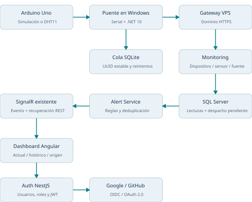

# Fase 4 — documentación técnica y operativa completa

Climate Monitoring System. Edición consolidada: 4 de noviembre de 2026, zona America/Mexico_City. Incluye los cambios posteriores al cierre local: despliegue Docker en VPS, GitHub real, Arduino Uno, puente HTTPS y adaptación DHT11.

## 1. Resumen de la entrega

La fase incorpora autenticación externa y adquisición de temperatura por Arduino en la arquitectura de microservicios existente. Auth centraliza Google OIDC y GitHub OAuth; Monitoring recibe telemetría autorizada por dispositivo, persiste lecturas y reutiliza el motor de alertas y el hub SignalR. Angular muestra temperatura actual e histórica por sensor, comunidad, fuente y última comunicación.

El Arduino Uno no realiza solicitudes HTTPS directamente: produce JSON por USB. Una aplicación .NET en la computadora conectada a la placa lee el puerto y publica al dominio del VPS. La PC debe permanecer encendida y conectada para transmitir.

Este documento sustituye las afirmaciones de estado de los informes iniciales que todavía consideraban todo despliegue VPS y prueba física pendientes. La implementación de código y los resultados automatizados se distinguen de las comprobaciones aportadas por el usuario. No se declara Kubernetes desplegado.

## 2. Estado comprobado y límites de evidencia

| Elemento | Estado al cierre de esta edición | Base de la afirmación |
|---|---|---|
| Auth, Gateway, Monitoring y Angular | Código implementado y compilado | Código fuente y pruebas registradas |
| Google OIDC | Integrado y probado con proveedor simulado | Pruebas OIDC; sin confirmación de login Google real |
| GitHub OAuth | Login real confirmado por el usuario | Conversación y diagnóstico de su VPS; no prueba remota autónoma de esta generación |
| VPS Docker Compose | Usuario mostró servicios saludables y endpoints del dominio | Salidas aportadas; no es un inventario remoto consultado al generar el PDF |
| Arduino Uno | Detectado COM3; compilación real; carga del simulador confirmada por usuario | Arduino CLI y salida de upload aportada |
| Telemetría al dominio | Puente mostró HTTP200 después de actualizar Monitoring | Salida del usuario; confirma aceptación de la lectura por el backend |
| DHT11 físico | Adaptador compilado y protocolo compatible | Flash 5626 bytes, RAM 243 bytes; falta confirmar carga/medición física DHT11 |
| Humedad DHT11 | Campo auxiliar en JSON serial | No existe ingestión independiente de humedad en el puente actual |
| Kubernetes/K3s | No ejecutado | Solo manifiestos/documentación existentes |

No se atribuye una calibración o medición térmica real a una prueba con datos simulados. Una respuesta HTTP200 tampoco es, por sí sola, evidencia visual del dashboard productivo; la publicación/actualización se comprobó en integración local y debe verificarse en el navegador del dominio.

## 3. Alcance y continuidad de Fase 3

Se conservaron las entidades Sensor y Comunidad, los contratos públicos del Gateway, los JWT/roles, la simulación del servidor, los reportes, la auditoría y los servicios propietarios de sus datos. No se creó otro microservicio ni un hub exclusivo para Arduino.

El alcance inicial excluía operaciones VPS. Posteriormente el usuario solicitó actualizar su despliegue existente y ejecutó los comandos documentados de Docker Compose, dominio HTTPS y configuración OAuth. No se instalaron ni aplicaron clústeres Kubernetes desde esta fase.

| Servicio | Tecnología / persistencia de la implementación | Responsabilidad |
|---|---|---|
| Auth | NestJS / PostgreSQL | Usuarios, proveedores, roles, sesión y JWT |
| Gateway | ASP.NET Core / YARP | Rutas públicas, validación JWT, proxy y CORS |
| Sensor | .NET / SQL Server | Catálogo, tipo, unidad, estado y comunidad |
| Community | .NET / PostgreSQL | Propiedad de comunidades |
| Monitoring | .NET / SQL Server | Ingestión, lecturas, históricos, simulación y SignalR |
| Alert | Java Spring Boot / PostgreSQL | Reglas, niveles y deduplicación de evaluaciones |
| Event | .NET / SQL Server | Eventos climáticos existentes |
| Audit | Python FastAPI / MongoDB | Auditoría asíncrona existente |
| Report | Python FastAPI / MongoDB | Reportes existentes |
| Web | Angular / Chart.js | Login, dashboard, administración y visualización |
| ArduinoBridge | .NET 10 / SQLite local | Serial, autorización de dispositivo, cola y HTTPS |

Versiones verificadas durante la implementación: .NET 10, openid-client 6.8.8, Arduino IDE 2.3.10, Arduino CLI 1.5.1, Arduino AVR Boards 1.8.8, DHT sensor library 1.4.7 y Adafruit Unified Sensor 1.1.15. El frontend usa Angular 22.2.3 según el proyecto. El VPS documentado utiliza MongoDB 7 por compatibilidad; no montar allí los volúmenes de MongoDB 8.

## 4. Arquitectura de extremo a extremo



En telemetría, el Gateway transforma `/api/monitoring/telemetry` en `/api/v1/monitoring/telemetry`. Monitoring deriva comunidad/tipo/unidad del catálogo de sensores. El identificador del sensor se configura en el puente, no se obtiene del nombre del sketch.

El flujo de identidad es independiente de la credencial IoT. El puente no usa la cuenta administradora, el token de una persona ni el Client Secret de GitHub.

## 5. OAuth 2.0, OIDC y sesión

### 5.1 Proveedores implementados

Google usa OIDC discovery con issuer `https://accounts.google.com`. openid-client valida nonce, claims y firma del ID token con verificación de no repudio habilitada. GitHub usa Authorization Code OAuth2, PKCE y su API de perfil/correos; no se le atribuye emisión de ID tokens para login de usuarios. Su issuer configurado es `https://github.com/login/oauth`.

El usuario registra su propia OAuth App y obtiene Client ID/Secret. El código no inventa credenciales ni necesita Kong o Keycloak para este diseño. Auth sigue siendo el punto central de identidad y el Gateway conserva la función de proxy y protección de APIs.

### 5.2 Flujo seguro

1. Angular genera un verifier aleatorio, conserva su valor en sessionStorage y envía su challenge a Auth.
2. Auth genera state, verifier PKCE del proveedor, nonce OIDC y vínculo al navegador mediante cookie HttpOnly.
3. El estado de cinco minutos se guarda en PostgreSQL; el state y el vínculo de cookie se almacenan como hashes.
4. El proveedor retorna al callback del mismo dominio HTTPS.
5. Auth verifica cookie/state y consume el flujo. Valida la respuesta del proveedor e identidad/correo verificado.
6. Auth produce un código propio de uso único con vigencia de 60 s y challenge del navegador. No coloca JWT en query string.
7. Angular limpia el fragmento y canjea ese código con su verifier; Auth emite el JWT del sistema.
8. Guards/interceptor y los servicios continúan aplicando roles, firma, issuer, audience y expiración.

La cookie usa Secure en callbacks HTTPS, SameSite=Lax, HttpOnly y Path=/. No debe quitarse la validación de cookie/state para resolver un error de despliegue. Reintentar desde `/login`: recargar un callback consumido no reinicia el flujo.

### 5.3 Cuentas y permisos

Se conservan Administrator, Operator y Viewer, equivalentes funcionales a ADMIN, OPERATOR y VIEWER. Los nuevos usuarios externos reciben Viewer, nunca administración automática. La contraseña local de una cuenta exclusivamente externa no es utilizable para login local.

No se fusionan cuentas solo porque compartan correo. Un correo que pertenece a una cuenta local requiere vinculación autenticada explícita. Existe endpoint backend de vinculación con AuthGuard, pero no se documenta una pantalla de vinculación que no se haya implementado. Cuenta inactiva no recibe JWT en el canje.

Logout conserva la revocación implementada en Auth y limpia sesión/conexión del cliente. La revocación inmediata global de JWT en cada microservicio no se añadió; los validadores locales siguen respetando la expiración configurada.

### 5.4 Contratos OAuth y rutas

| Ruta pública Gateway | Uso y protección |
|---|---|
| GET /api/auth/oauth/{provider}/start?challenge=... | Inicio público con challenge válido |
| GET /api/auth/oauth/{provider}/callback | Público respecto a JWT humano; valida state/cookie/proveedor |
| POST /api/auth/oauth/exchange | Código propio de un uso y verifier del navegador |
| POST /api/auth/oauth/{provider}/link | Requiere identidad JWT mediante AuthGuard |

La ruta YARP `oauth-public` tiene prioridad-20 y política Anonymous. Eso no elimina el guard del endpoint link. No abrir todo el backend ni eliminar la política de las rutas administrativas.

## 6. Configuración OAuth local y VPS

La configuración privada productiva usa estos nombres y ejemplos sin valores reales:

```dotenv
OAUTH_FRONTEND_URL=https://analisissistemas2026proyecto.xyz
OAUTH_GITHUB_CLIENT_ID=CONFIGURAR_CLIENT_ID
OAUTH_GITHUB_CLIENT_SECRET=CONFIGURAR_SECRET_PRIVADO
OAUTH_GITHUB_CALLBACK_URL=https://analisissistemas2026proyecto.xyz/api/auth/oauth/github/callback
OAUTH_GOOGLE_CLIENT_ID=CONFIGURAR_CLIENT_ID
OAUTH_GOOGLE_CLIENT_SECRET=CONFIGURAR_SECRET_PRIVADO
OAUTH_GOOGLE_CALLBACK_URL=https://analisissistemas2026proyecto.xyz/api/auth/oauth/google/callback
```

Google y GitHub se configuran por separado: uno puede funcionar aunque falten las credenciales del otro. Registrar el callback exacto en cada proveedor. Para desarrollo se utiliza localhost; para VPS se mantiene el dominio HTTPS y OAUTH_ALLOW_LOCAL_HTTP=false. Es preferible separar las aplicaciones OAuth de desarrollo y producción.

Un archivo `.env` sirve como fuente para interpolación de Compose, pero no inyecta automáticamente cada variable al contenedor. El servicio identity-service necesita su mapping environment en el overlay OAuth. No copiar esos secretos a Angular ni al puente.

El frontend genera runtime-config.json desde GATEWAY_PUBLIC_URL. En producción:

```json
{"production":true,"apiUrl":"https://analisissistemas2026proyecto.xyz","realtime":{"enabled":true,"hubUrl":"https://analisissistemas2026proyecto.xyz/hubs/monitoring"}}
```

GATEWAY_PUBLIC_URL de Compose y Backend.BaseUrl del puente son configuraciones diferentes. Cambiar una no modifica la otra. No mezclar el overlay local docker-compose.phase4.yml, que fija localhost, con el despliegue productivo.

## 7. Arduino Uno: dos firmwares diferentes

| Archivo | Entrada | Origen emitido |
|---|---|---|
| hardware/arduino/temperature-sensor/temperature-sensor.ino | Onda de temperatura sin sensor, SIMULATE_SENSOR=1 | SIMULATED |
| Mismo archivo con SIMULATE_SENSOR=0 | Ejemplo de referencia LM35 en A0, ADC 5 V / 10 bits | ARDUINO |
| backend/lecturas-sensor/lecturas-sensor.ino | DHT11 físico con DATA en pin digital2 | ARDUINO |

Se carga un sketch a la vez: el último reemplaza el anterior. El Arduino conserva el programa al desconectarse de la PC. No dispone de Wi-Fi/Ethernet por este diseño y no conoce el UUID del backend.

El firmware simulado produce entre20y40°C cada 2 s; el DHT11 toma muestras cada 3 s. Ambos usan millis para evitar delay de muestreo en el loop y emiten un JSON terminado en newline. La librería DHT requiere su temporización de lectura interna; no se declara que toda operación de sensor sea no bloqueante.

### 7.1 Cableado de referencia

En el DHT11 usar el pin de datos del módulo hacia D2, tierra común y alimentación conforme a la etiqueta/especificación del módulo. No asumir orientación de pines por color o forma. Un sensor suelto de cuatro pines puede necesitar pull-up según fabricante; un módulo puede incorporarlo. La referencia LM35 usa salida analógica a A0 y conversión10mV/°C, ajustando la referencia ADC al voltaje real.

El firmware no es universal para DHT22, DS18B20 u otras placas: adaptar lectura, librería y cableado conservando el contrato serial. No se afirma calibración física por una compilación exitosa.

### 7.2 Protocolo serial v1

```json
{
  "protocolVersion": 1,
  "deviceId": "arduino-temp-001",
  "sensorType": "TEMPERATURE",
  "value": 27.5,
  "unit": "C",
  "source": "ARDUINO",
  "sequence": 125
}
```

Sin reloj confiable en el Uno se omite timestamp y el puente asigna UTC de recepción. No se generan fechas ficticias. Sequence es contador de muestras; el UUID estable para reintentos HTTP se genera y persiste en el puente antes de enviar.

El DHT11 añade sensor y humidity como campos auxiliares. Actualmente se ignoran para ingestión: el dashboard recibe temperatura, no una segunda lectura de humedad. Los errores DHT11_READ_FAILED se registran/rechazan como errores de sensor, no como temperatura0.

## 8. Compilar y cargar Arduino

En Windows se preparó Arduino IDE 2.3.10, CLI1.5.1 y AVR Boards 1.8.8. El Uno fue identificado en COM3 por Arduino CLI. Otro equipo puede asignar otro puerto. DHT requiere DHT sensor library de Adafruit y Adafruit Unified Sensor; referencias al final.

Desde raíz Windows, con puente y Monitor Serial cerrados:

```powershell
# Verificar simulador sin cargar
powershell -NoProfile -ExecutionPolicy Bypass -File tools/Arduino-Uno.ps1
# Cargar simulador
powershell -NoProfile -ExecutionPolicy Bypass -File tools/Arduino-Uno.ps1 -Upload -PortName COM3
# Verificar DHT11 sin cargar
powershell -NoProfile -ExecutionPolicy Bypass -File tools/Arduino-Uno.ps1 -SketchPath backend/lecturas-sensor
# Cargar DHT11
powershell -NoProfile -ExecutionPolicy Bypass -File tools/Arduino-Uno.ps1 -SketchPath backend/lecturas-sensor -Upload -PortName COM3
```

El comando sin -SketchPath selecciona el simulador anterior. No ejecutar las dos cargas si se quiere conservar una sola modalidad. El Monitor Serial se configura a 9600 baudios y se cierra antes de abrir el puente. No se necesitan drivers adicionales si Windows ya reconoce el puerto; un conversor USB distinto exige revisar su driver particular.

## 9. Puente C# .NET 10

La aplicación Worker/Console utiliza DI, IOptions validadas, ISerialDataSource, System.IO.Ports, BackgroundService, IHttpClientFactory, ILogger y CancellationToken. Program.cs se limita a configuración y composición de servicios.

AcquisitionWorker abre el puerto o lo detecta si existe exactamente uno, lee frames acotados a 4096 caracteres, valida JSON/dispositivo/unidad/rango y asigna sensor/UTC/UUID. SerialDataSource también permite generar muestras sin hardware mediante -Simulate.

TransmissionWorker publica lo persistido usando X-Device-Token. No requiere usuario administrador. Dos PCs no deben emitir simultáneamente con la misma identidad. La protección del lanzador evita duplicar instancias del mismo lanzador en una sesión Windows; no es un bloqueo distribuido entre PCs.

### 9.1 Archivos de operación

| Archivo | Contenido y tratamiento |
|---|---|
| tools/Climate.ArduinoBridge/appsettings.json | Puerto, dominio, UUID y límites; configuración privada del equipo |
| tools/Climate.ArduinoBridge/device-token.local | Token original; no versionar ni compartir públicamente |
| backend/.env.phase3.local | Parámetros del entorno; en VPS es privado y conserva secretos de sus servicios |
| backend/docker-compose.arduino.vps.yml | Mapping de ARDUINO_* al servicio Monitoring; no contiene secretos reales |
| Archivo SQLite configurado | Pendientes del puente; conservar al reiniciar y no mezclar con otro dispositivo |

El archivo appsettings.example.json es un ejemplo local; no copiarlo sin ajustar el dominio HTTPS. El token se inyecta por el lanzador y no forma parte del JSON compartido del ejemplo.

### 9.2 Configuración conceptual

```json
{
  "Arduino": { "PortName": "COM3", "BaudRate": 9600, "ReconnectSeconds": 5, "Simulate": false },
  "Backend": { "BaseUrl": "https://analisissistemas2026proyecto.xyz", "TelemetryPath": "/api/monitoring/telemetry", "TimeoutSeconds": 10, "AllowLocalHttp": false },
  "Device": { "DeviceId": "arduino-temp-001", "SensorId": "UUID_REAL_DEL_SENSOR_VPS" },
  "Buffer": { "Path": "arduino-vps-buffer.db", "MaxReadings": 10000, "RetentionHours": 168 }
}
```

Este JSON usa un marcador de UUID, no un valor ejecutable. No se cambia el UUID al azar: debe existir como sensor activo de temperatura en el VPS.

## 10. Buffer, reintentos y límites

SQLite usa WAL y FIFO por rowid. Cada payload se guarda antes de publicar; el UUID no cambia en reintentos HTTP. Se elimina después de una respuesta exitosa. Backend caído, fallo de red, 429 y 5xx provocan backoff de 2 a 64 s.

| Condición | Política implementada |
|---|---|
| HTTP 200 / 2xx | Eliminar pendiente confirmado y continuar |
| HTTP 401 / 403 | Detener envío, conservar pendientes y pedir corregir autorización; reiniciar después |
| HTTP 400 / 404 / 409 y otros 4xx permanentes distintos de 429 | Registrar rechazo y eliminar ese pendiente; no reintentar para siempre |
| Retención superada | Registrar vencimiento y descartar al despachar |
| Límite de filas alcanzado | Diagnóstico explícito de buffer lleno y reconexión/adquisición interrumpida |

Por defecto se admiten 10 000 lecturas pendientes y 168 h. El límite es de filas, no una cuota exacta de bytes SQLite/WAL. La falta de entrega no es una garantía ilimitada: muestras fuera de los límites pueden perderse. Un 404 de despliegue se debe corregir con el puente detenido porque se considera rechazo permanente.

Al cambiar de UUID o destino, usar una cola independiente y conservar la anterior para recuperación controlada. No editar UUID/source dentro de payloads ya pendientes para forzar su aceptación. Un nuevo UUID no mueve los históricos anteriores.

## 11. API de telemetría y persistencia

Ruta externa: POST `https://analisissistemas2026proyecto.xyz/api/monitoring/telemetry`. Interna: POST `/api/v1/monitoring/telemetry`. El Gateway permite llegar a la ruta sin JWT humano y Monitoring exige credencial de dispositivo.

```json
{
  "readingId": "UUID_ESTABLE_DE_LECTURA",
  "sensorId": "UUID_EXISTENTE_DEL_SENSOR",
  "deviceId": "arduino-temp-001",
  "value": 27.5,
  "unit": "C",
  "measuredAt": "2026-11-04T20:00:00Z",
  "source": "ARDUINO"
}
```

Es un ejemplo de contrato; fecha y UUID reales los construye el puente. Header privado: X-Device-Token. El servidor compara SHA256 del token en tiempo constante y limita su uso al dispositivo/sensor/source configurados. Un JWT humano por sí solo no autoriza ingestión.

Se comprueban UUID válido, dispositivo activo/registrado, sensor existente y activo, Temperature, unidadC/°C, decimal con máximo4decimales, rango configurable por defecto-55..150°C y fecha entre7días anteriores y 5 minutos futuros. La propiedad value es obligatoria; JSON incompleto no se convierte silenciosamente en cero.

SensorReading conserva el modelo existente y agrega Source, DeviceId y TelemetryDispatched mediante migración20261029000100_Phase4Telemetry. Históricos anteriores usan SIMULATED. El sensor/comunidad no se duplican. La asociación vive en Telemetry.Devices y la comunidad procede del catálogo.

### 11.1 Idempotencia y auditoría

ReadingId es clave primaria. La búsqueda/inserción usa bloqueos SQL UPDLOCK/HOLDLOCK y reutiliza la transacción abierta por el filtro de auditoría. Si no hay transacción, el controlador crea una serializable. Repetir UUID con los mismos datos devuelve la lectura; cambiar sensor/dispositivo/valor/source/fecha produce 409. Conflictos SQL transitorios pueden provocar 5xx y reintento del puente.

Se corrigió una transacción anidada detectada en la integración inicial. No se eliminó el filtro de auditoría para evitar el error.

## 12. Alertas y entrega de eventos

Una lectura aceptada queda persistida antes de confirmar HTTP. Un worker consulta hasta 100 lecturas pendientes, ordenadas por fecha, cada 2 s y ejecuta el evaluador de Alert existente. El servicio Java deduplica por readingId para no repetir alertas por reintentos de la misma lectura.

Después se publica SensorReadingUpdated en el hub actual y se marca el despacho. Un fallo conserva el estado pendiente. La entrega es al menos una vez: si el proceso cae después de publicar y antes de marcar, SignalR puede repetirse. Los consumidores hacen upsert/recuperación REST. No se promete que un navegador desconectado reciba cada evento histórico individual.

Se preservan los niveles Verde, Amarillo, Naranja y Rojo y las reglas configurables del sistema. El formato de una lectura física y simulada recorre el mismo pipeline de evaluación.

## 13. Dashboard, históricos y comunicación

La gráfica de temperatura utiliza SensorChart existente e incorpora un selector de sensor y comunidad. Muestra valor/°C, último timestamp, origen y comunicación reciente/obsoleta. El histórico viene del backend, agrupado por bucket y source. ARDUINO y SIMULATED tienen estilos distinguibles; Angular no inventa temperaturas.

SignalR dispara sincronización del panel y REST recupera estado cada 5 s; la infraestructura existente también reconecta. Después de 30 s sin lectura, por defecto, se muestran datos obsoletos. Ese umbral se puede configurar mediante input del componente; no se deduce conexión únicamente porque el sensor exista en la base.

Crear un sensor en el catálogo no lo asocia a Arduino. Mientras su UUID no aparezca en Telemetry.Devices, el simulador del servidor puede generarle valores. Una vez asociado, queda excluido del simulador y de la inserción manual, incluso si se inactiva el dispositivo, para no aparentar lecturas físicas frescas.

Si el puente apunta al dominio, el dashboard local puede quedar obsoleto: son bases y destinos diferentes. No interpretar el cambio de PC o el prefijo del nombre del sensor como una migración de datos.

## 14. Despliegue y actualización en el VPS

Proyecto Docker existente: climate-phase3-vps. Backend documentado: `/opt/climate/climate_backend`. Frontend: `/opt/climate/Climate_Frontend`, enlazado desde `/opt/climate/frontend/climate-monitoring-web`. Proxy público existente: Nginx; Gateway enlazado a 127.0.0.1:18080 en el override Hostinger. Estas rutas describen la instalación reportada, no una instalación universal.

### 14.1 Publicación y pull

Solo se descargan cambios que ya se publicaron en GitHub. `.env.phase3.local`, configuración privada del puente y token no deben versionarse. Revisar `git status --short` antes de un pull; usar `git pull --ff-only` y resolver divergencias explícitamente, sin borrar cambios por rutina.

```bash
cd /opt/climate/climate_backend
git status --short
git pull --ff-only
git -C ../frontend/climate-monitoring-web status --short
git -C ../frontend/climate-monitoring-web pull --ff-only
```

### 14.2 Compose y conservación de datos

Conservar el mismo project-name y los mismos volúmenes. El overlay MongoVPS mantiene MongoDB 7 y sus volúmenes separados. El overlay de dominio fija URL pública del frontend; el OAuth inyecta parámetros a identity-service; el Arduino inyecta ARDUINO_* a monitoring-service. No se debe perder un overlay al recrear servicios con otra lista Compose.

Para cambiar un servicio, recuperar sus archivos reales desde sus labels. Ejemplo completo para Monitoring:

```bash
cd /opt/climate/climate_backend
CONFIG_FILES=$(docker inspect --format '{{ index .Config.Labels "com.docker.compose.project.config_files" }}' climate-phase3-vps-monitoring-service-1)
IFS=',' read -r -a FILES <<< "$CONFIG_FILES"
COMPOSE=(docker compose --project-name climate-phase3-vps --env-file .env.phase3.local)
for FILE in "${FILES[@]}"; do COMPOSE+=(-f "$FILE"); done
"${COMPOSE[@]}" config --quiet
```

Si CONFIG_FILES sale vacío, detenerse y verificar el nombre del contenedor. Si se trata de un overlay nuevo, agregarlo al final de COMPOSE como en las guías anexas. Cerrar la terminal pierde esa variable, pero no borra los archivos ni datos.

### 14.3 Diferencia entre configuración e imagen

Cambiar environment requiere recrear el contenedor, no recompilar. Cambiar C#/TypeScript/frontend requiere construir la imagen antes del up. `--no-build` solo usa la imagen que ya existe; no incorpora un endpoint nuevo.

```bash
# Solo cambia UUID/token/source, con la imagen actual ya validada
"${COMPOSE[@]}" up -d --no-deps --no-build --force-recreate --wait --wait-timeout 180 monitoring-service
# Cambia codigo de Monitoring
"${COMPOSE[@]}" build monitoring-service &&
"${COMPOSE[@]}" up -d --no-deps --no-build --force-recreate --wait --wait-timeout 180 monitoring-service
```

No ejecutar down-v, borrar volúmenes ni seeds completos para aplicar un cambio de UUID. Build antes de up permite conservar el contenedor anterior si la construcción falla. El reinicio puede interrumpir brevemente el servicio; no se documenta despliegue sin interrupción garantizado.

## 15. Diagnósticos reales resueltos durante la fase

| Síntoma observado | Diagnóstico | Corrección y comprobación |
|---|---|---|
| Healthy pero conexión Windows cerrada | Health interno no prueba el puerto publicado | Recrear solo Gateway/frontend; arranque local verifica endpoint público antes del seed |
| Callback con issuer GitHub y401 | Metadata usaba https://github.com en vez de /login/oauth | Corregir issuer y reconstruir Auth; prueba reproduce y rechaza issuer ajeno |
| Callback401 vacío, WWW-Authenticate:Bearer | Gateway antiguo exigía JWT antes de Auth | Reconstruir Gateway con oauth-public; curl sin sesión llega a Auth |
| SESSION_MISSING tras prueba curl | Curl no lleva cookie/state de un flujo | Resultado esperado sin login; iniciar un flujo nuevo en navegador |
| runtime-config apunta localhost | Frontend productivo usa URL local | Inyectar dominio en frontend y recrearlo; runtime-config confirma HTTPS |
| PROVIDER_NOT_CONFIGURED | Faltan variables dentro de Auth aunque estén en .env | Agregar mapping OAuth al overlay y recrear solo Auth |
| Sensor local obsoleto / VPS genera solo | Bases distintas y UUID VPS sin asociación IoT | Configurar UUID real del VPS, overlay y reiniciar Monitoring |
| POST telemetría404 | Imagen Monitoring anterior sin controlador nuevo | Build+up de Monitoring; prueba incompleta cambia a 400 y puente a 200 |
| Error de transacción anidada | Filtro audit ya abrió transacción | Reutilizar transacción y bloqueos de idempotencia |

Diagnóstico de Auth usa etiquetas fijas en logs y headers X-OAuth-Error/X-OAuth-Reference, sin códigos OAuth, cookies, tokens ni secretos. ACCOUNT_LINK_REQUIRED significa que el correo pertenece a una cuenta que requiere vinculación; no se evita eliminando la validación. Los errores de certificado se corrigen con confianza válida, no desactivando TLS.

## 16. Pruebas, resultados y evidencia

Últimas ejecuciones automatizadas registradas a lo largo de la fase, no una nueva ejecución masiva al generar este PDF:

| Grupo | Último resultado registrado | Cobertura destacada |
|---|---|---|
| Auth | 14 aprobadas | JWT, contraseñas, callback GitHub/issuer, Google simulado, nonce/firma/claims, diagnóstico sin secretos |
| Monitoring | 18 aprobadas | Regresión, sensores inexistentes/inactivos, exclusión del simulador |
| ArduinoBridge | 13 aprobadas | JSON/campos requeridos, rango, dispositivo, TLS, SQLite/reinicio/UUID/límite, reconexión,401,503→200 |
| Angular | 57 aprobadas | Contratos/guards y panel que actualiza histórico/valor/obsolescencia |
| Integración local | 15 comprobaciones aprobadas | HTTP, SQL, UUID idempotente, alertas, SignalR, puente simulado |
| Edge local | Tres auditorías sin violaciones detectadas | Login, dashboard escritorio/móvil, sin errores JS y responsive |

Son 102 pruebas automatizadas en los últimos resultados registrados, más las comprobaciones de integración y navegador. La primera entrega tenía99; las pruebas de issuer/diagnóstico añadidas posteriormente explican la diferencia.

Artefactos conservados: docs/validation/phase4-integration.json, phase4-browser.json, capturas del dashboard; scripts tools/phase4-integration.mjs y phase4-browser.mjs. Los scripts son de entorno local y pueden registrar/actualizar la asociación demo local. No ejecutarlos contra producción como si fueran una prueba de solo lectura.

Compilación Arduino simulador: 3920 bytes flash, 204 bytes RAM; DHT11: 5626 bytes flash, 243 bytes RAM. El usuario aportó carga exitosa del simulador Uno y respuesta HTTP 200 de la telemetría al VPS. DHT11 tiene compilación real pero no una lectura física confirmada en esta edición. No se incorpora un certificado de calibración inexistente.

Para repetir pruebas desde raíz Windows:

```powershell
node backend/src/Services/AuthService/node_modules/typescript/bin/tsc -p backend/src/Services/AuthService/tsconfig.json
node --test backend/src/Services/AuthService/tests/*.test.cjs
dotnet test backend/tests/Climate.Monitoring.Tests/Climate.Monitoring.Tests.csproj --no-restore
dotnet test tools/Climate.ArduinoBridge.Tests/Climate.ArduinoBridge.Tests.csproj
```

Angular se comprueba desde frontend/climate-monitoring-web con el Node compatible tools/node/node.exe:

```powershell
../../tools/node/node.exe node_modules/@angular/cli/bin/ng.js test --watch=false
../../tools/node/node.exe node_modules/@angular/cli/bin/ng.js build
../../tools/node/node.exe node_modules/@angular/cli/bin/ng.js lint
```

## 17. Seguridad y gestión de configuración

Este PDF no contiene credenciales reales, valores de .env, token IoT, Client Secrets, contraseñas, JWT ni cookies. Los ejemplos usan marcadores. Los archivos privados no se copian automáticamente a otra PC por Git.

Secretos compartidos durante soporte deben rotarse. La rotación de contraseñas DB debe coordinarse con el servicio/base que las usa; cambiar solo `.env` no cambia la contraseña persistida de una base existente. No utilizar esta documentación como sustituto de un plan de backup/restauración de producción.

Mantener HTTPS en el VPS, CORS con dominio explícito y token IoT por dispositivo. El hash del token se registra en servidor, el original se protege en PC. Para otro dispositivo independiente usar sensorId/deviceId/credencial propios y ampliar Telemetry.Devices; el overlay entregado configura un dispositivo en posición0.

## 18. Requisitos oficiales pendientes y límites de cierre

La implementación OAuth/IOT y la operación Docker confirmada no cumplen por sí mismas la finalización oficial de Kubernetes/K3s. La matriz adjunta usa IDs RF/RNF oficiales y etiquetas locales K8S/ARD ligadas a secciones. No se atribuye prueba productiva a una prueba local.

| Requisito oficial / adicional | Estado | Motivo pendiente | Implementación reutilizable | Dependencia externa | Acción del responsable | Cómo verificar | Riesgo |
|---|---|---|---|---|---|---|---|
| RF-OAUTH-03: Google real | Código y proveedor simulado | No se confirmó login con credenciales reales | OAuthService, Angular y tests OIDC | OAuth App Google y cuentas de prueba | Registrar callbacks y probar flujo real | Login, rol Viewer y rechazo de respuestas inválidas | Restricciones reales del proveedor sin validar |
| Arduino: medición DHT11 | Adaptador compilado | Falta confirmación de carga y medición física DHT11 | Sketch, puente y API | Sensor, cableado y referencia térmica | Revisar conexiones y comparar medición | JSON serial, HTTP200 y valor coherente en dashboard | Lecturas inválidas o desviación sin detectar |
| §10: clúster K3s | No instalado | Ejecución Kubernetes excluida | backend/k8s | VPS autorizado y recursos | Dimensionar y preparar clúster en tarea posterior | Nodos Ready y reinicio controlado | Sin orquestación Kubernetes demostrada |
| §11: Pods | No validados en clúster | No se aplicaron manifiestos | Deployments existentes | Clúster operativo | Desplegar imágenes revisadas | Pods Ready, logs y reinicios | Fallos reales de arranque desconocidos |
| §11: Deployments | No aplicados | Despliegue K3s no ejecutado | Manifiestos de Fase3 | Registry y clúster | Preparar rollout y rollback | rollout status y recuperación de versión | Sin recuperación productiva demostrada |
| §12: Services internos | No comprobados en K8s | Compose no prueba DNS/selectores K8s | Contratos/Services existentes | DNS de clúster | Revisar selectores y puertos | Consultas internas desde Pod autorizado | APIs internas inaccesibles |
| §12: Ingress | No implementado en K3s | Nginx del VPS no es Ingress validado | Gateway y rutas del dominio | Controller e ingressClass | Configurar host/rutas y WebSocket | REST y SignalR por Ingress | Tiempo real o callbacks podrían fallar |
| §13: ConfigMaps | Preparación por entorno | No se aplicaron al clúster | Opciones de servicios | Endpoints internos definitivos | Inyectar parámetros no sensibles | Configuración efectiva y health | URLs/flags productivos incorrectos |
| RNF-OAUTH-02 / §13: Secrets K8s | Pendiente | .env productivo no acredita Kubernetes Secrets | Inyección por entorno | Almacén seguro y credenciales | Provisionar, limitar acceso y rotar secretos | Login/APIs sin exponer valores | Exposición de secretos o indisponibilidad |
| §14: Persistent Volumes/PVC | No migrados a K3s | Persistencia de clúster fuera del alcance ejecutado | Bases y volúmenes Docker existentes | StorageClass y backups | Configurar PVC y restauración de prueba | Reiniciar Pod y recuperar datos | Pérdida de datos en migración |
| §14: liveness/readiness | Endpoints y health Docker existentes | Falta ejecutar probes en K3s | /health y /health/live | Clúster operativo | Configurar probes y fallos controlados | Tráfico solo a instancias listas | Tráfico a procesos no disponibles |
| Objetivo7: escalabilidad horizontal | No medida | No se probó despliegue multirréplica | UUID idempotente y Deployments | Recursos, balanceo y backplane SignalR | Diseñar distribución antes de escalar Monitoring | Eventos recibidos entre réplicas | Clientes pierden actualizaciones entre instancias |
| Objetivo8: DNS | Dominio operativo reportado | Administración y renovación fuera de esta generación | URLs configurables | Propiedad del dominio/proveedor DNS | Conservar registros y monitoreo | Resolución desde clientes externos | Dominio inaccesible por cambios o vencimiento |
| Objetivo8 / §9: TLS público | HTTPS operativo reportado | No se emitió ni probó renovación aquí | Nginx y callbacks HTTPS | CA, dominio y tarea de renovación | Revisar cadena, vigencia y renovación | HTTPS válido y renovación controlada | Interrupción al expirar certificado |
| Referencia oficial Fase1 | URL respondió404 | Fuente remota no disponible | Referencias Fases2/3/4 guardadas | Documento del responsable académico | Solicitar y conservar fuente | Contrastar matriz con requisitos originales | Trazabilidad incompleta de Fase1 |

## 19. Organización del código y entrega

| Ubicación | Cambio principal |
|---|---|
| backend/src/Services/AuthService/src/oauth.ts | Proveedores, flujos, PKCE, cuentas externas y sesión |
| backend/src/Services/AuthService/src/oauth-diagnostics.ts | Clasificación segura de errores |
| backend/src/Gateway/Climate.Gateway/appsettings.json | Rutas OAuth/telemetría públicas específicas |
| backend/src/Services/MonitoringService | Controlador, opciones, entidad/migración y despacho persistente |
| frontend/climate-monitoring-web/src/app | Login externo, servicios y gráfica de temperatura |
| tools/Climate.ArduinoBridge | Worker serial/HTTP, protocolo, opciones y SQLite |
| tools/Arduino-Uno.ps1 | Compilar/cargar Uno con sketch seleccionable |
| backend/lecturas-sensor/lecturas-sensor.ino | Adaptador DHT11 físico |
| hardware/arduino/temperature-sensor/temperature-sensor.ino | Simulación y ejemplo LM35 |
| backend/scripts/Configure-Phase4Arduino.ps1 | Configurar asociación/token sin duplicar claves |
| backend/docker-compose.arduino.vps.yml | Inyectar asociación Arduino al VPS |
| docs/GUIA_ARDUINO_CAMBIAR_SENSOR_UUID.md | Procedimiento completo de cambio de asociación |
| docs/GUIA_ARDUINO_NUEVA_PC.md | Puesta en marcha en otro Windows |

Los overlays privados OAuth/dominio creados en la VPS pueden no formar parte del repositorio. Conservarlos en todas las actualizaciones que afecten sus servicios. Herramientas, .ino y guías fuera del repo backend no se transfieren a otra PC haciendo únicamente pull del backend.

## 20. Operación diaria y recuperación

Con Arduino ya programado y VPS operativo, solo se conecta USB, se cierra Monitor Serial y se ejecuta el puente:

```powershell
powershell -NoProfile -ExecutionPolicy Bypass -File tools/Climate.ArduinoBridge/Start-ArduinoBridge.ps1 -PortName COM3 -Configuration Release -NoBuild
```

Compilar si cambia código .NET; cargar firmware si cambia el sketch; recrear Monitoring si cambia UUID/token/source; actualizar frontend si cambia su código o URL pública. No hacer todas esas operaciones para cada encendido.

Las dos guías anexas contienen pasos completos sin depender de comandos de una conversación anterior. Al retomar, registrar el paso alcanzado y consultar:

```powershell
Get-Content .\FASE_4_PROGRESO.md
```

La regeneración del documento no instala controladores, no carga firmware ni ejecuta comandos contra el VPS. Archivo fuente y generador quedan incluidos para actualizar el PDF sin repetir la implementación.

## 21. Referencias técnicas

- Requisito principal: phase_4.md de la raíz y docs/references/phase_4.official.md, con Fases2/3 oficiales conservadas.
- Google OAuth/OIDC: https://developers.google.com/identity/protocols/oauth2/web-server
- Google OIDC: https://developers.google.com/identity/openid-connect/openid-connect
- GitHub OAuth: https://docs.github.com/en/apps/oauth-apps/building-oauth-apps/authorizing-oauth-apps
- Issuer GitHub: https://docs.github.com/en/apps/github-authentication-discovery-endpoints
- Cliente: https://github.com/panva/openid-client
- Docker Compose: https://docs.docker.com/reference/cli/docker/compose/up/
- .NET Windows: https://learn.microsoft.com/es-es/dotnet/core/install/windows
- Arduino CLI: https://docs.arduino.cc/arduino-cli/installation
- Arduino IDE: https://support.arduino.cc/hc/en-us/articles/360019833020-Download-and-install-Arduino-IDE
- DHT Adafruit: https://github.com/adafruit/DHT-sensor-library

Los anexos del PDF incorporan íntegramente las dos guías operativas actuales, la matriz actualizada y ambos firmwares. Los documentos de cierre local anteriores se conservan como historial; este estado consolidado es el vigente para la fase.
