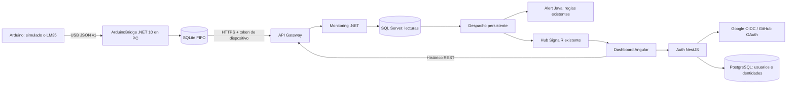

# Entrega de Fase 4 — alcance local

Implementación local terminada y validada. La Fase 4 oficial completa no se declara cerrada: Google/GitHub reales, Arduino físico y operación Kubernetes requieren dependencias externas o están expresamente excluidos. Fecha: 2026-10-29, America/Mexico_City.

## Resultado y arquitectura



Auth usa Authorization Code con PKCE, state y cookie HttpOnly; Google valida nonce, firma JWKS, issuer/audience y expiración con openid-client. GitHub consulta identidad/email verificado mediante OAuth, sin atribuirle OIDC. Angular canjea un código de 60 s con PKCE propio y conserva la sesión/JWT existente. Los nuevos usuarios externos son Viewer; una colisión de email exige vinculación autenticada y explícita. No se inventaron credenciales.

El endpoint público es `POST /api/monitoring/telemetry`; Monitoring recibe `/api/v1/monitoring/telemetry`. Exige un token de dispositivo de alcance limitado y verifica su hash, sensor, fuente, tipo, actividad, unidad, rango, timestamp y UUID. La persistencia comparte la transacción de auditoría y usa bloqueos por UUID. Los reintentos equivalentes no crean otra lectura. La evaluación persistente reutiliza las reglas y deduplicación de Alert Java, publicando por el hub existente. El simulador del servidor excluye sensores asociados; el resto sigue activo.

SQL Server agrega `Source`, `DeviceId` y `TelemetryDispatched` mediante migración aditiva. Auth agrega tablas de flujos/códigos OAuth al esquema existente. No se borraron datos ni se duplicó Sensor. SQLite pertenece al puente y no cambia las bases productivas.

La gráfica de temperatura existente se reutiliza por sensor, con histórico del backend y líneas diferenciadas por fuente. Muestra valor, °C, comunidad, última lectura y comunicación reciente/obsoleta; se recupera por REST al desconectarse. Se corrigieron ancho móvil y contraste detectados por pruebas. Ningún dato aleatorio se genera en Angular.

## Archivos creados y modificados

Backend, rutas relativas a `backend/`:

- Nuevos: `docker-compose.phase4.yml`, `scripts/Start-Phase4.ps1`, `scripts/Configure-Phase4Arduino.ps1`.
- Auth nuevos: `src/Services/AuthService/src/oauth.ts`, `tests/oauth.test.cjs`, `tests/oidc.test.cjs` dentro de AuthService.
- Auth modificados: Dockerfile, package.json/package-lock.json, src/main.ts y src/database.ts.
- Monitoring nuevos: `Climate.Monitoring.Application/Readings/TelemetryOptions.cs`, `Climate.Monitoring.Api/Controllers/TelemetryController.cs`, `Climate.Monitoring.Api/Realtime/TelemetryDispatchWorker.cs` y migración `20261029000100_Phase4Telemetry.cs`.
- Monitoring modificados: Program.cs, MonitoringService.cs, ReadingModels.cs, SensorReading.cs, SensorReadingConfiguration.cs y MonitoringDbContextModelSnapshot.cs.
- Gateway: `src/Gateway/Climate.Gateway/appsettings.json`, dos rutas específicas; se conserva formato anterior.
- Pruebas: `tests/Climate.Monitoring.Tests/Readings/TelemetryTests.cs`.

Frontend, rutas relativas a `frontend/climate-monitoring-web/src/app/`:

- Nuevos: `features/monitoring/components/temperature-panel.ts` y su `.spec.ts`.
- Modificados: core/auth/auth-api.service.ts, auth.service.ts; login-page.ts/html; dashboard-page.ts/html; sensor-chart.ts; monitoring.models.ts; active-alerts-panel.html.

Raíz del workspace:

- `hardware/arduino/temperature-sensor/temperature-sensor.ino`: simulación activada por defecto, LM35 de referencia configurable.
- `tools/Climate.ArduinoBridge/`: proyecto, opciones, protocolo, fuente serial, cola, workers, ejemplo de configuración, script de inicio y .gitignore.
- `tools/Climate.ArduinoBridge.Tests/`: pruebas sin hardware.
- `tools/phase4-integration.mjs`, `phase4-browser.mjs`, `phase4-update.py`, `phase4-doc-matrix.py`, `fetch-phase-references.py`.
- `FASE_4_PROGRESO.md`; siete documentos obligatorios de alcance, OAuth, Arduino, telemetría, exclusiones, matriz y pruebas, más este informe.
- `docs/references/`: requisitos oficiales Fases 2, 3 y 4; Fase 1 respondió HTTP 404.
- `docs/validation/phase4-integration.json`, `phase4-browser.json` y capturas del dashboard.

Se generan archivos privados ignorados: `.env.phase3.local`, appsettings.json del puente y device-token.local. No versionar ni compartir sus valores. No se cambiaron manifiestos Kubernetes ni infraestructura externa.

## Cómo iniciar

Desde PowerShell en la raíz:
```powershell
powershell -NoProfile -ExecutionPolicy Bypass -File backend/scripts/Start-Phase4.ps1 -NoBuild
```
El stack quedó iniciado con 17 servicios saludables. Frontend: http://localhost:4200; Gateway: http://localhost:8080. El overlay fuerza conexiones locales aunque el archivo de Fase3 contenga otra URL pública. La cuenta inicial se consulta en el archivo privado, sin copiar credenciales al informe.

Para generar datos de prueba sin hardware, en otra terminal:
```powershell
powershell -NoProfile -ExecutionPolicy Bypass -File tools/Climate.ArduinoBridge/Start-ArduinoBridge.ps1 -Simulate
```
Ya quedó asociado el sensor demo **Arduino temperatura demo**, código `ARDUINO-PHASE4-DEMO`, con comunidad existente. Seleccionarlo en la gráfica de temperatura. El puente se mantiene en primer plano y se detiene con Ctrl+C. El script impide duplicar otra instancia que use el mismo lanzador. No se dejó un puente oculto consumiendo datos tras las pruebas.

Con Arduino: abrir/subir el sketch en Arduino IDE, usar SIMULATE_SENSOR=1 para generar datos desde la propia placa y cerrar Monitor Serial. Ejecutar:
```powershell
powershell -NoProfile -ExecutionPolicy Bypass -File tools/Climate.ArduinoBridge/Start-ArduinoBridge.ps1 -PortName COM3
```
Cambiar COM3 por el puerto real. Para LM35 usar SIMULATE_SENSOR=0 y configurar Source ARDUINO con Configure-Phase4Arduino.ps1; detalles, cableado y comandos en `FASE_4_ARDUINO.md`. No se afirma que una placa real se haya probado.

Para reconstruir cambios omitir `-NoBuild`. En instalación sin imágenes previas, `-BuildAll` requiere acceso válido a feeds/CA Maven. El comando exacto con CA para Auth está en `FASE_4_ALCANCE.md`.

## Validación y límites

99 pruebas automatizadas aprobadas: Auth 11, Monitoring 18, puente 13 y Angular 57. Build/lint de Angular y compilaciones .NET/TypeScript aprobados. Quince verificaciones de integración real HTTP/SQL/SignalR, incluida transmisión desde el puente .NET simulado. Edge comprobó botones externos, login local, actualización de temperatura, gráfico y responsive; tres auditorías de accesibilidad sin violaciones detectadas. Ver `FASE_4_PRUEBAS.md` para comandos y limitaciones.

Cumplido localmente: código OAuth/OIDC y sesión, JWT/roles, firmware de referencia, puente serial/simulado, buffer/reintentos, endpoint autenticado, persistencia, idempotencia, reglas, SignalR, dashboard, convivencia con simulador y documentación.

Parcial o externo: login real Google/GitHub sin Client IDs/Secrets; compilar/cargar firmware con core/placa real y probar USB/sensor. Sin prueba física no se atribuye calidad de medición ni compatibilidad universal de hardware.

Fuera de ejecución: despliegue K3s, Pods en VPS, Ingress productivo, DNS/TLS públicos, nodos, escala real, backplane SignalR y almacenamiento/Secrets productivos. Detalle individual, responsable, verificación y riesgo en `FASE_4_PENDIENTES_FUERA_SCOPE.md`; 42 filas de trazabilidad en `FASE_4_MATRIZ_REQUISITOS.md`.

Para retomar desde el punto comprobado sin recrear lo existente:
```powershell
Get-Content .\FASE_4_PROGRESO.md
```
